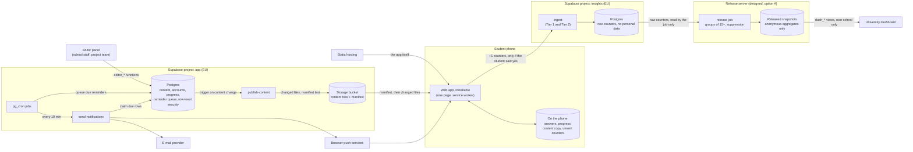
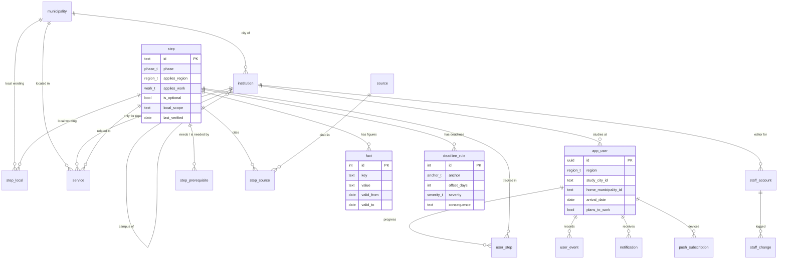
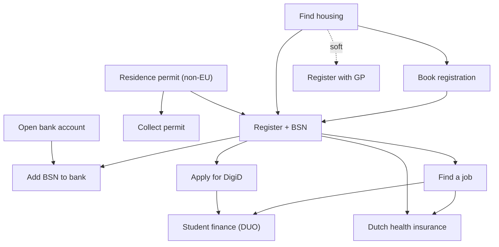

# Netherlanded: architecture

*CBS group project, International Business year 1. Rewritten 16 November 2026 to describe the system as it is now; statistics consent updated 18 November 2026 (policy 1.7); release step added 19 November 2026. Every count and name in this document was read from the local database and the source on that date. Earlier versions of this file mixed the original plan with later updates; the history is in section 15.*

> **Where things stand.** The app runs as a prototype in the browser: checklist, deadlines, scam check, local help, 18 city themes, opt-in anonymous statistics. The server side (two databases, three server functions, scheduled jobs) is written and tested on a local PostgreSQL 16. **Nothing is deployed, the app has no sign-in, and progress lives only on the student's phone.** The database side of accounts exists (section 7a). What is still to do is in `CHECKLISTS.md`.

---

## 1. Purpose and scope

The app gives first-year international students one personal checklist for moving to the Netherlands, from before they arrive through their first months: housing, residence permit, municipal registration and BSN, bank, insurance, GP, work and settling in. It shows each student only the steps that apply to them, in the right order, with deadlines worked out from their own dates, and it says what a missed deadline costs.

| | Count |
|---|---|
| Study cities with their own colours, local texts and services | 18 |
| Other municipalities a student can live in (commuter towns) | 16 |
| Schools | 18, with 11 further campuses |
| Steps | 19 (14 required, 5 optional) |
| Hard and soft dependencies between steps | 14 |
| Local texts (a step's wording for one municipality) | 129 |
| Local services (GPs, housing, support, government, communities) | 149 |
| Sources | 32, of which 20 official |
| Current figures (CAK fine, bank deadline and so on) | 11 |
| Deadline rules | 7 |
| Scam check questions | 8 |

The first version was written for THUAS in The Hague. Other cities were added as content rows, not as new structure.

---

## 2. System overview

*Picture versions are kept with the project deliverables: the data model (PNG, 16 November 2026) and, since 19 November 2026, two architecture charts with the release step: `netherlanded-architecture-separate-server.png` (option A, shown above) and `netherlanded-architecture-job.png` (option B, the release step as a scheduled job inside the insights project; see section 8). The mermaid blocks here are the source of truth.*

**Five parts, kept apart on purpose:**

| Part | Holds | Trusts |
|---|---|---|
| The phone | The student's answers and progress, a copy of the content | Only content that matches its fingerprint and has the right shape (section 6) |
| App database | Content, and (once accounts exist) each student's own rows | Nobody by default: every table has row-level security |
| Insights database | Raw anonymous counters only. No personal data, no link to the app database. Universities cannot read it | Only `ingest`, through a role that can do nothing else |
| Release step (designed) | Reads the raw counters, applies disclosure control and writes anonymous snapshots. Universities read only these | Nothing from outside. Runs as a job, no student or university can call it |
| Static host and storage bucket | The app and the published content files | Public and read-only. A changed file fails its fingerprint, but see the limit in section 6 |

The original plan was a React Native app with a SQLite cache. The prototype became an installable web app instead: no app store, one codebase.

---

## 3. The app on the phone

**One page, built from parts.** `tools/build.py` joins `src/index.html`, 32 style files and 18 script parts (`src/js/00-core.js` to `99-end.js`) into one page. The script parts share one function scope and are joined in name order; nothing is a module. That keeps the single-file build possible, at the cost that any part can reach any other part's variables (section 13).

| Script part | Does |
|---|---|
| `01-state` | Loads and saves the student's answers and progress |
| `02-cities` | City palettes and theme variables for 18 cities, light and dark |
| `03-logic` | Which steps apply, which are locked, deadlines, "Up next", counts |
| `04-header`, `05-views`, `07-step-sheet`, `08-full-screen-pages` | The screens |
| `09-onboarding-survey`, `13-first-run-profile-setup`, `12-terms-agreement` | Setup, the agreement screen and, after it, the separate statistics choice |
| `11-sound`, `16-open-from-reminder` | Sounds, reminder preview, calendar file, opening a step from a reminder |
| `14-content-update` | Applies newer content that the loader saved |
| `15-anonymous-totals` | Makes the "+1" counters and sends them, only after the student said yes |

**Three builds from the same source:**

| Build | For | Notes |
|---|---|---|
| `dist/site/` (about 860 KB) | The hosted app | Service worker (opens offline), web app manifest (installs to the home screen), `content/` beside the page, content loader |
| `dist/netherlanded.html` (about 540 KB) | Sending as one file | No network access at all, by policy |
| `--fragment` | claude.ai artifacts (the Final and Square links) | The page without `<html>` and `<head>` |

**What is kept on the phone** (browser storage, per browser):

| Key | Holds |
|---|---|
| `aankomst-v2` | Answers and progress: region, school, cities, arrival date, work plan, ticked steps, recorded events, name and photo |
| `nl-setup` | Half-finished setup answers |
| `nl-terms` | Which policy version was agreed to |
| `nl-consent` | The Tier 2 statistics choice (yes, no or later), its version and date |
| `nl-basic`, `nl-basic-off`, `nl-basic-seen` | Tier 1 counts not yet sent, whether the student objected, and which notice version they saw |
| `nl-stats` | Counters made but not yet sent. Exists only after a yes; deleted on no or when switched off |
| `nl-content` | Downloaded content newer than the build's own copy |

"Delete all my data" clears all of these except `nl-content`, which is not personal.

**The same rules exist twice.** The phone works out which steps apply, which are locked and when things are due in `03-logic.js`. The database does the same in `step_applies()`, `v_user_checklist` and `v_user_deadlines`. The phone's version is what students see today; the database's version is what reminders and accounts will use. They were written to match and the content export feeds both. `tests/test_parity.py` runs eight students through both and fails if they disagree on which steps apply, their state, or a due date. One known difference is latent: the phone ignores a step limited to one city or to a school's campus, and no step uses either yet.

**Page security.** The hosted page and the single file carry a Content-Security-Policy that allows only the page's own scripts, each by its hash, computed at build time. An injected script or an `onerror=` handler does not run. Content is embedded as JSON with every `<` escaped, and the build refuses broken JSON. Fonts are self-hosted, so opening the app contacts no third party.

**Design layers.** "Final" is the source as built. "Square" is the same build plus two style sheets added after the build (`square.css`, `plain.css`): flat full-width lists, heavy rules, small-capital tags. Square is not in `src/` yet, so the hosted build and the tests do not cover it (section 13).

---

## 4. Data model: app database

**Content tables** (the same for everyone; changed only through `editor_*` functions or by the project team):

| Table | Holds |
|---|---|
| `municipality` | 34 places: 18 study cities and 16 towns students live in. Registration page, booking notes, the international centre, when it was last checked |
| `institution` | 18 schools and their 11 campuses (`campus_of`), each in a city, with housing service and permit-collection notes |
| `step` | One checklist item: phase, who it applies to, why and how, whether it is optional, and whether its local wording follows the study city or the home municipality (`local_scope`) |
| `step_local` | A step's wording, links and sources for one municipality |
| `step_prerequisite` | "Step A needs step B first", hard or soft |
| `source`, `step_source` | Every cited page, with an "official" flag, and which steps cite it |
| `fact` | A changing figure with a validity period. Never overwritten: a new version is inserted |
| `deadline_rule` | A due date counted from an anchor, its severity, and what happens if it is missed (`consequence`, with `{fact_key}` placeholders) |
| `service` | Local GPs, housing, support, government desks and communities |
| `scam_check_question` | Weighted yes/no questions with an explanation each |
| `content_change` | Log of every changed figure |

**Personal tables** (one student's own rows):

| Table | Holds |
|---|---|
| `app_user` | Display name, region, optional country, school, study city, home municipality, arrival date, work plan, reminder switches |
| `user_step` | Status per step (todo, in progress, done, skipped), completion date, optional note, when it last changed |
| `user_event` | Dated events: first working day, CAK letter, bank account opened. A removed event stays as a row without a date |
| `notification` | Reminder outbox: what to send, when, attempts, last error |
| `push_subscription` | The devices that receive push reminders, at most 5 per student |

**Staff tables:** `staff_account` (editor for one school, or admin) and `staff_change` (who changed what, with before and after).

The buddy tables in the first design were dropped by `database/13_cleanup.sql`.

---

## 5. Key logic

**Personalisation (`step_applies`).** A step appears only if region and work plan match, and, where a step names one, the city and school. A non-EU student who only studies gets the three non-EU steps (residence permit, collecting it, the optional TB test) but not `find_job`, `dutch_insurance` or `student_finance`. Student finance appears only for EU/EEA students who work. Local wording comes from `step_local` for the student's home municipality or study city, depending on the step's `local_scope`; a step with no local row falls back to the national text.

**Lock and unlock (`v_user_checklist`).** A step is locked while at least one hard prerequisite that also applies to this student is not done. Two details:
- A soft prerequisite never locks. `register_gp` has a soft link to `find_housing`.
- A prerequisite that does not apply is ignored. `register_municipality` needs `residence_permit`, but an EU student never sees the permit step.

*Solid arrow: hard (locks). Dotted: soft (advice only). All 14 arrows are the rows of `step_prerequisite`.*

**Deadlines (`deadline_rule` → `v_user_deadlines`).** A deadline is an anchor plus days:

| Step | Counted from | Days | Severity |
|---|---|---|---|
| Residence permit documents | Arrival | −90 | Advice |
| Book registration | Arrival | −14 | Advice |
| Register at the municipality | Arrival | +5 | Legal |
| Register with a GP | Arrival | +14 | Advice |
| Add BSN to the bank | The day `open_bank` was done | +90 | Financial |
| Dutch health insurance | First working day | 0 | Legal |
| Answer the CAK letter | Date on the letter | +90 | Financial |

With no anchor date there is no due date and no reminder. Every legal or financial rule carries a `consequence` sentence, shown under "If you miss the deadline" and in the reminder; `{cak_fine_eur}` and similar are filled from the current fact, so a new amount updates every screen.

**Up next.** The first available required step, except that a required step with a legal or financial deadline overdue or due within 7 days comes first.

**Versioned figures.** An editor inserts a new `fact` row. The trigger `on_fact_insert` closes the previous version, logs old and new in `content_change`, and queues a notice for every student the step applies to. `v_current_fact` returns the version valid today.

**Stale content (`v_stale_content`).** Lists steps, figures and services not checked for more than 180 days, oldest first.

**Cycle check (`assert_no_cycles`).** A trigger refuses a dependency that would make two steps lock each other.

**Rules the database enforces itself.** Only optional steps can be skipped. A step marked done needs a completion date. A single tick of a step is refused while a hard prerequisite is open (`check_step_unlocked`); a sync may store that state, because the phone allows it. Content text has size limits and links must be `https://`.

---

## 6. Content: from the database to the phone

1. An editor saves through an `editor_*` function. It checks that the editor may change that city, and logs the change.
2. A trigger calls `publish-content`. A job repeats the call every ten minutes in case one was missed.
3. The function asks the database for every content file's exact text and its fingerprint (`content_files()`): `core` plus one file per study city, 19 files. The fingerprint is the first 16 hex characters of the SHA-256 of the text.
4. It uploads only the files whose fingerprint differs from the published manifest, and uploads the manifest last, so a phone never sees a manifest that names a file not yet there.
5. On each open the phone fetches the manifest. If its version is new, it downloads the changed files, hashes each one and compares it with the manifest, then checks the shape of the content. Only if everything passes is it saved.
6. The next open shows the new content.

The page always carries a full copy of the content from build time, so a first open, an offline open or a failed download still shows a complete app.

**What the fingerprint protects against:** a half-downloaded file, a cache serving an old file beside a new manifest, a file changed after publishing.
**What it does not:** whoever controls the host or the publish step can serve a harmful file with a matching fingerprint, because the manifest comes from the same place. Signing the manifest with a key built into the app would close that (section 13).

---

## 7. Reminders

Reminders use an outbox. Jobs and triggers only insert `notification` rows; one function sends them.

1. `queue_deadline_reminders()` runs daily and queues a reminder 7 days before and on the day, in Dutch time, only for students who switched reminders on.
2. Every ten minutes `send-notifications` claims the rows that are due (`claim_due_notifications`), so two runs never send the same one.
3. It sends each by push, e-mail or both, according to the student's switches, and reports back (`finish_notification`).
4. A failed message is retried up to five times. A push address that no longer exists is removed. A push address that is not a real push service (Google, Mozilla, Apple, Microsoft) is never contacted.
5. Finishing a step or switching reminders off cancels its queued reminders.

Reminders need accounts, which do not exist yet. Today the app shows a preview of a reminder and can make a calendar file with every deadline.

---

## 7a. Accounts and sync (database side built 16 Nov 2026)

The phone stays the working copy, so the app works offline. A signed-in phone sends what it has to one function and gets the merged state back.

| Function | Does |
|---|---|
| `sync_progress(payload)` | Merges profile, steps and events. The first call creates the account |
| `my_state()` | The account's current state |
| `export_my_data()` | Everything stored about the caller (right of access) |
| `delete_my_account()` | Removes the account, everything attached to it, and the sign-in |

**Merge rule.** Per item (the profile, each step, each event) the latest change wins. Two "done" marks keep the earlier completion date. An un-ticked step and a removed event stay as rows, so an older phone cannot bring them back. A change time in the future counts as now.

All four run only for a signed-in student and only on their own rows. The monthly purge removes the sign-in as well as the account.

**Not built:** the app side. There is no sign-in screen, the app does not call `sync_progress()`, and it does not yet record when each item was changed, which the merge needs.

**Considered for later (18 Nov 2026):** once accounts exist, count the university statistics on the server from the progress accounts already hold, instead of counters on the phone. That removes device storage for statistics altogether. Accounts would stay optional, offered with e-mail reminders.

---

## 8. Insights database

A second, separate database gives a partner university anonymous totals about its own new international students. It holds no personal data and has no connection to the app database.

**In.** The phone sends small increments ("+1 completed register_municipality"), each at most once, only if the student said yes to sharing, the terms are agreed, the plan is not the sample plan and the school is listed. `ingest` passes each to `ingest_checked()`, which applies the limits and then `ingest()`. `ingest()` refuses any field outside a fixed list (no user id, device id, name or address). Nothing about the request is stored.

**Cohort.** Since 18 November 2026 the app groups counters by intake semester (`intake`, for example `2026-sep`: arrivals August to January join the September intake, February to July the February intake). `ingest()` still expects the Monday of the arrival week and must be changed to accept the semester before anything is sent.

**Limits.** 600 per source per 10 minutes (in the function's memory), 2,000 per minute overall and 20,000 per hour per school (in the database, `ingest_limit`). These cap the damage from fake counters; they do not prevent it.

**Out (designed 19 November 2026).** Universities no longer read the raw counters, not even through views. A release step reads them, applies disclosure control (`legal/DISCLOSURE_CONTROL.md`) and writes anonymous snapshots. Signed-in staff read five views over the snapshots only, each filtered to their own school:

| View | Shows |
|---|---|
| `dash_summary` | Students taking part, share arrived, average completion, share registered with a GP, share who missed the 5-day registration |
| `dash_step_completion` | Per step: share completed, share on time, share who opened it |
| `dash_stuck_points` | The three required steps with the lowest completion per intake |
| `dash_deadline_missed` | Share who missed each deadline, by severity |
| `dash_scam_exposure` | Scam checks done and the share that ended as likely a scam |

**What the release step does:**
- Runs monthly and writes a fixed snapshot. Staff never see live counts.
- Releases a figure only if its cohort (school and intake semester), its metric denominator and each comparison group hold at least 15 students. Otherwise the view shows "Insufficient group size".
- Hides a figure that could be worked out by subtraction from released totals (complementary suppression).
- Hides a change over time that rests on fewer than 5 new contributions.
- Offers no filters, no exports and no row-level data.
- Counts Tier 1 and Tier 2 separately. A view built on Tier 2 shows only students who said yes.
- `purge_old()` still removes raw totals and old snapshots after the agreed period.

**Where the release step runs: two options, not yet decided.**

| | A. Separate release server | B. Scheduled job inside the insights project |
|---|---|---|
| Chart | `netherlanded-architecture-separate-server.png` | `netherlanded-architecture-job.png` |
| Raw counters | Stay in the insights project, which no university role can reach | Same database as the snapshots, split by schema |
| What stops a university reading raw counters | A different project and credentials | Roles and row-level security only, one misconfigured grant away |
| Cost and upkeep | A third project to set up, pay for and secure | Nothing new |
| Fit with the policy text ("only anonymous output reaches the university") | Strongest: the claim is true by structure | True by configuration; needs a test that fails if a university role can reach the raw schema |
| Recommendation | Choose if a university's privacy officer asks for separation | Enough for a pilot if the schema test exists |

**Built today** is the older design: `publish_snapshot()` runs every Monday, the views read its output, and a figure built on fewer than 10 students is left out. The release step above replaces it. Still to change: the threshold (10 to 15), the monthly schedule, subtraction suppression, the change-over-time rule, the Tier 1 and Tier 2 split, and `ingest()` accepting the intake semester.

---

## 9. Roles and security

**People:**

| Role | Can read | Can change |
|---|---|---|
| Student | All published content; only their own rows in the personal tables | Their own profile, progress, events and devices |
| Editor (one school) | What students see, plus stale content and their own change log | Local texts and services in their school's campus cities, through `editor_*` functions |
| Admin (project team) | Everything except students' free-text notes | Everything, including national content and figures |
| University staff | The five `dash_*` views for their own school, over released snapshots only | Nothing |

**Database roles:**

| Role | Used by | May do |
|---|---|---|
| `anon`, `authenticated` | The public API | Read content; `authenticated` reaches its own rows only, and may call the four account functions |
| `nl_sender` | `send-notifications` | Claim and finish reminders, read the e-mail address it needs |
| `nl_publisher` | `publish-content` | Read the content files |
| `insights_ingest` | `ingest` | Call `ingest_checked()` and nothing else |
| `insights_university` | Dashboard sign-ins | Read their own school's views over released snapshots. No access to raw counters (designed; a test must prove it) |
| `insights_release` (designed) | The release job | Read raw counters, write snapshots, nothing else |

**What holds this together:**
- Row-level security is on for every table, and views run with the reader's rights. A test fails if a table lacks it.
- Server-only functions are taken away from the public API. A test fails if a signed-in user can call anything outside a fixed list.
- A database test attacks as student A against student B, as an anonymous caller, and as an editor of one school against another school's cities.
- Two audit passes are written up in `SECURITY_AUDIT.md`. Pass 2 found and fixed content that could run code in every student's app, push addresses that let a student aim the server at any website, and unchecked content downloads.

**Not yet proven:** none of this has run on a live Supabase project. The attack list for the live project is in `SECURITY_AUDIT.md`. No outside person has reviewed it.

---

## 10. Privacy basics

- **Minimal data.** The profile holds a display name, region, optional country, school, cities, arrival date and work plan. No passport, permit or BSN number is stored; the BSN step records only that it is done.
- **Free text.** `user_step.note` can hold sensitive details. It is excluded from everything staff can read.
- **Reminders are opt-in.** Both switches start off, and every function that queues a reminder checks them.
- **Two tiers of anonymous totals (policy 1.9).** *Tier 1, basic app statistics:* on after the Terms, under the Dutch analytics exception (Telecommunicatiewet 11.7a) and legitimate interest (Art. 6(1)(f), `legal/LEGITIMATE_INTEREST_ASSESSMENT.md`), with an objection switch in Profile. Counts only app version, school, intake semester, broad step category and applies/finished, plus one technical-error count. Shown to students on a notice screen of its own (Continue / Object) before counting starts. Universities receive Tier 1 only as approved snapshots from a release function (15/15 rule, complementary and change suppression, monthly; `legal/DISCLOSURE_CONTROL.md`, not built). Stored in `nl-basic`, sent to `NL_BASIC_URL` (not built). *Tier 2, additional statistics:* the university counters, opt-in on consent (Art. 6(1)(a)). After the Terms, a separate screen asks once, with equal Yes and No buttons and a "Decide later" that asks once more after 3 finished steps or 3 weeks. Nothing is counted or stored for statistics before a yes; a no, or switching off later, deletes the counts on the phone.
- **Retention.** `purge_expired_data()` deletes an account 12 months after arrival. One delete of `app_user` removes progress, events, devices and reminders.
- **IP addresses.** The functions store and log nothing about a request, but Supabase's own gateway logs the client address (7 days on the Pro plan). The policy says so.
- **No controller is named yet.** That decision blocks launch.

---

## 11. Infrastructure

| Piece | Where it runs | State |
|---|---|---|
| Web app | Static hosting, built by `tools/build.py` | Workflow written, not run |
| App database | Supabase project "app", EU | Migrations generated from `database/`; a clean build is checked in CI |
| Content files | Public storage bucket, written by `publish-content` | Tested against a stand-in bucket |
| Reminders | `send-notifications`, every 10 minutes | Tested; the push message is decrypted in the test as a browser would |
| Counters | `ingest`, in the separate "insights" project | Tested against the real `ingest()`. Tier 1 endpoint (`NL_BASIC_URL`) not built |
| Release step | Option A: separate project; option B: job in "insights" (section 8) | Designed, not built. The Monday `publish_snapshot()` is what exists |
| Dashboard and editor | Pages in `dashboard/` and `editor/` | Database side tested; the pages run on built-in data |
| Scheduled jobs | pg_cron in each database | Each command is run by a check; the schedule itself is untested |

**Scheduled jobs (UTC):**

| Job | When | Does |
|---|---|---|
| `nl-queue-reminders` | Daily 04:05 | Queues deadline reminders |
| `nl-queue-checkins` | Daily 04:10 | Queues the monthly check-in |
| `nl-send-reminders` | Every 10 minutes | Calls `send-notifications` |
| `nl-publish-content` | Every 10 minutes | Calls `publish-content` |
| `nl-purge-accounts` | 1st of the month 03:30 | Deletes accounts 12 months after arrival |
| `nl-insights-snapshot` | Monday 03:00 | Rebuilds the university snapshot (built; the release step replaces it with a monthly run) |
| `nl-insights-release` (designed) | 1st of the month 03:00 | Runs the release step |
| `nl-insights-purge` | 1st of the month 04:00 | Removes old totals |

Two Supabase projects, one static host, one e-mail provider. Setup steps are in `infra/README.md`.

---

## 12. Tests

| Suite | Covers |
|---|---|
| `tests/run_sql.sh` (the SQL test files) | Rebuilds both databases from `database/01` to `27` and checks logic, access rules, the content export, server functions, counter limits, the attack tests and accounts |
| `pytest tests` (55 tests, in a real browser) | The app's flows, the build, offline use and content updates, counters against the real `ingest()`, hostile content and input, the hosted security policy, the staff pages, and the phone against the database for the same students |
| `deno test infra/tests` (3 tests) | The three server functions against the test databases |
| `tools/make_migrations.py --check` | A clean database exports exactly the committed content |

Not covered: a live Supabase project, real phones, iPhone Safari and the Square styling. The opt-in statistics screen (18 Nov) was checked in a headless browser: shown after the Terms, yes / no / later, re-ask timing, and deletion of counts.

---

## 13. Gaps and open decisions in the design

These are structural, not to-do items. Each needs a decision before or while accounts are built.

| # | Gap | Why it matters | Options |
|---|---|---|---|
| 1 | **The app has no sign-in, so nothing syncs.** The database side is built (section 7a). | A new phone or a cleared browser loses everything. Reminders cannot be sent. | Build the sign-in screens on Supabase Auth, record change times on the phone, call `sync_progress()`. Needs a live project to test. |
| 2 | ~~Sync has no conflict rule.~~ **Decided and built:** per item the latest change wins; "done" keeps its first completion date. | | |
| 3 | ~~The phone and the database disagree about un-ticking.~~ **Decided and built:** the database check guards a single tick; a sync stores what the phone has. The other choice (un-ticking re-locks later steps on the phone) is still open if user tests show the current behaviour confuses students. | | |
| 4 | ~~The rules exist twice with no test comparing them.~~ **Built:** `tests/test_parity.py`. One latent difference remains: the phone ignores a step limited to a city or to a school's campus. | Harmless until a step uses either. | Bring the phone's rule in line before adding such a step. |
| 5 | **The manifest is not signed.** | A compromised host or publish step can serve harmful content with a matching fingerprint. | Sign the manifest in `publish-content` with a private key; build the public key into the app; the phone refuses an unsigned or wrongly signed manifest. Needs a decision on who holds the key. |
| 6 | **Square is a layer outside the source.** | The hosted build and all tests use Final. Square cannot be deployed as it is. | Merge the two style sheets into `src/css/` and remove what they override, or drop Square. |
| 7 | **One function scope for all script.** | Fine at this size, but any part can break another, and nothing can be tested in isolation. | Leave it until the app grows; then split into modules and bundle. Not urgent. |
| 8 | **Prerequisites cannot say "either A or B".** | Some real rules are alternatives. | Add a group column to `step_prerequisite` when the first such rule is needed. |
| 9 | **Country is collected but unused**; the bank deadline is 90 days for everyone. | Some rules depend on nationality or on the bank. | Leave until content needs it. |
| 10 | **Editors of two schools share a city** and can change the same local text. | No owner for shared content. | One owner per city, or an admin approves changes to shared cities. |
| 11 | **The static host cannot send security headers** if it is GitHub Pages. | The page can be framed by another site. | Choose a host that sets `frame-ancestors 'none'`, or accept it. |
| 12 | **English only.** | Some students would be helped by other languages. | A `step_translation` table when it is decided. |
| 13 | **The release step is designed but not built, and its location is undecided.** | Until it exists, universities would read the old weekly snapshot with a threshold of 10, which does not match the policy text (15). With a pilot-sized cohort most figures will be hidden. | Pick option A or B (section 8), build the release function and the test that no university role reaches raw counters, then switch the dashboard views to it. |

---

## 14. Build order from here

1. Decide the controller (blocks everything public). The statistics default is decided: opt-in.
2. A no-accounts pilot: host the app, sharing opt-in, test with real students on real phones.
3. Deploy both databases and the three functions; change `ingest()` to the intake semester; run the live attack list.
4. The app side of accounts (gap 1), then reminders.
5. Connect the editor panel and the dashboard; first partner school.
6. Manifest signing (gap 5) before any outside editor can publish content.

---

## 15. History

| Date | Change |
|---|---|
| 28 Sep 2026 | Desk research; first schema, logic and seed for THUAS in The Hague |
| 19 Oct 2026 | Content fact-checked against official sources (`FACT_CHECK.md`) |
| 28 Oct 2026 | Buddy programme removed from the prototype; insights database added |
| 12 Nov 2026 | Row-level security, city and campus model, database-enforced rules (`08_fixes.sql`) |
| 13 Nov 2026 | Source split into parts with a build and tests; content export with fingerprints; server functions, jobs, staff roles; buddy tables dropped |
| 14 Nov 2026 | Counter limits; security audit passes 1 and 2; consequences on deadlines; 7 more cities; Final build |
| 15 Nov 2026 | Square styling layer and its A/B round |
| 16 Nov 2026 | This document rewritten to match the system as built. Accounts, database side: sync with a merge rule, data export, account deletion; phone-against-database test |
| 18 Nov 2026 | Policy 2.0: Tier 1 notice screen; Tier 1 to universities only via disclosure control (k = 15). Policy 1.9: two-tier statistics (basic app statistics on with objection; university statistics opt-in). Policy 1.8: statistics on legitimate interest with a written balancing test, device permission through the opt-in screen. Policy 1.7: statistics opt-in, asked on a separate screen after the Terms; counters grouped by intake semester; court clause fixed ("final-legal" build) |
| 19 Nov 2026 | Release step added to the design: a job reads the raw counters, applies disclosure control and writes anonymous snapshots; universities read only these. Two charts (separate server, job inside insights); decision open |

---

## Appendix: research findings and the features that answer them

| # | Research finding | Feature | Implemented by |
|---|---|---|---|
| 1 | Information provision "not yet in order" (ResearchNed/LSVb 2026); only 39% satisfied with pre-arrival housing information | One checklist in phases, with why, how and sources on every step | `step`, `step_source`, `source`, `v_user_checklist` |
| 2 | Steps must happen in a fixed order | Steps stay locked until what they depend on is done | `step_prerequisite`, `v_user_checklist`, `assert_no_cycles()` |
| 3 | EU/EEA and non-EU students follow different procedures; work changes the rules | Setup questions that filter the checklist | `app_user`, `step.applies_*`, `step_applies()` |
| 4 | About 70% met housing scams; shortage of about 20,200 homes | Scam check and a list of housing options | `scam_check_question`, `service` |
| 5 | The CAK fine changes every year (€529.74 in 2026); other sites show old amounts | Figures stored with validity dates; a notice when one changes | `fact`, `v_current_fact`, `on_fact_insert` |
| 6 | A CAK letter must be answered within 3 months; Dutch insurance is required from the first working day | Deadlines counted from the student's own events, with the consequence | `deadline_rule`, `user_event`, `v_user_deadlines` |
| 7 | The BSN must reach the bank within 90 to 120 days | Reminder counted from the day the account was opened | `deadline_rule` on `open_bank` |
| 8 | In The Hague more than 75% of GP practices take no new patients | GP step with a deadline, and practices that accept students | `register_gp`, `service` (24 GP entries) |
| 9 | 70% did not know about student finance (now at least 32 hours a month, lowered from 56 hours) | Money and insurance steps, with the threshold stored as a figure | `plan_finances`, `student_finance`, `fact` |
| 10 | Non-EU students collect their permit in person; the IND is busiest May to July | Permit steps and a deadline 90 days before arrival | `residence_permit`, `collect_permit` |
| 11 | 60% find it hard to connect with Dutch students; 62% often stressed | Optional social steps and a monthly check-in. Buddy matching was planned and removed | `intro_week`, `join_community`, `wellbeing_checkin` |
| 12 | Popular websites show outdated figures | Content not checked for 180 days is flagged | `last_verified`, `v_stale_content` |

Open research gaps: no figure for GP registration among international students; registration waiting times per city are missing; UAS and non-EU students are thin in the research; the "1 in 3 without a GP" figure is the group's own estimate and must be labelled as such.
